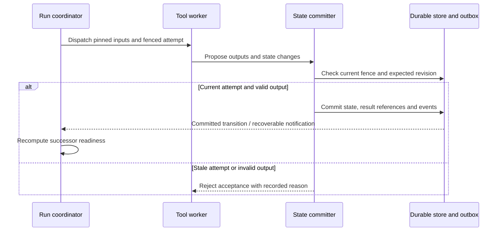

# Runtime State and Recovery

- Design status: detailed proposed contract; implementation and scientific acceptance pending
- Naming note: component/record/operation names below are proposed logical design, not implemented APIs or selected deployment technology
- Last reviewed: `2026-09-22 18:56:40` (America/Chicago)
- Parent: [Domain overview](Campaign_Architecture.md)
- Requirement source: [Product Requirements](../Product_Requirements.md#tool-node-and-runtime-boundaries)

## Owned Contract

Runs bind campaign/lockfile revisions to inputs, node/iteration/attempt identities, snapshots and durable transitions. Runtime owns scheduling, readiness, state commits, checkpoints, cancellation, retries and external-job reconciliation. Parallel work uses revision/ownership checks and explicit merge policies.

Invocation follows resolve/validate -> record attempt -> execute -> validate outputs -> commit accepted state/results -> route. Operational completion is distinct from scientific disposition. State scopes include campaign, node, iteration and candidate; retained evidence is not automatically computational state or feedback.

## Boundary and Flow

Tools return typed results and declared state changes. Platform supplies durable transaction/outbox and execution mechanisms; Campaigns defines transitions. Agent tasks bind into the same execution view. External calls retain logical idempotency keys and provider handles; ambiguous completion pauses for reconciliation.

## Invariants and Verification

Readers see committed state. Retries preserve logical identity and distinct attempts. Model/knowledge updates enter at declared boundaries. Checkpoint migration is explicit. Verify restart, stale/duplicate completion, concurrent isolation, cancellation, exhausted loops and audit-write failure. Deterministic fixtures replay exactly; external/nondeterministic work exposes limits.

## Component and Object Design

| Proposed component | Authoritative responsibility |
|---|---|
| Run coordinator | Run revision, current execution position, admissible commands and iteration boundaries |
| Readiness evaluator | Dependency/branch/join conditions over committed results |
| Dispatcher and attempt registry | Invocation identity, worker lease/attempt fencing and external job references |
| State committer | Expected-revision checks, accepted outputs/state transitions and durable event commitment |
| Recovery reconciler | Checkpoint rehydration, orphan/stale attempts and external completion reconciliation |

`Run`, `NodeExecution`, `Attempt`, `StateRevision` and `Checkpoint` are distinct records. State values may reference large immutable artifacts. Worker-local scratch state is disposable; accepted state is not. A checkpoint binds graph/lockfile/state versions and completed transition position, not merely a serialized in-memory object.

## Completion Protocol

1. Read a consistent readiness/state snapshot and allocate a logical invocation.
2. Claim an attempt with a bounded lease and monotonic fencing token.
3. Execute with pinned inputs, state and limits; retain provisional artifacts.
4. Accept completion only if invocation, token, expected state and outputs remain valid.
5. Commit state, output references and audit/outbox records as one recoverable decision.
6. Release eligible successors; notification delivery alone is not the source of readiness.

A late response from an expired worker is retained diagnostically but cannot overwrite accepted state. Exactly-once external execution is not assumed: submission uses a provider idempotency key where supported, otherwise ambiguous completion requires reconciliation.

## Failure and Boundary Example

If two workers finish the same node, only the current fenced completion may commit. If the process crashes after committing but before notifying successors, recovery derives readiness from committed state/outbox and does not rerun the scientific calculation unnecessarily. A cancelled lab job may still produce a result; retain it and route through policy instead of claiming the external action was undone.

## Design Basis and Open Decisions

[Invocation and Recovery Specification](../Scientific_Tools_and_Graph_Execution.md) supplies state/replay requirements. System selects the PostgreSQL transactional baseline. Initial scope is one active autonomous campaign with parallel node attempts; human changes apply to later campaigns. Remaining choices include lease timing, within-campaign resource allocation and checkpoint cadence; multi-campaign fairness is deferred. These need concurrency/crash fixtures before operational guarantees are claimed.
