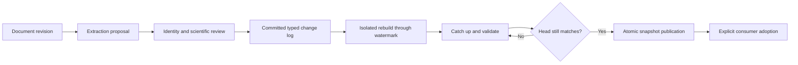

# Text Authoring and Graph Revisions

- Design status: B1-B2 typed authoring and rebuild publication implemented; process/replacement proof, extraction and scientific acceptance remain pending
- Naming note: component/record/operation names below are proposed logical design, not implemented APIs or selected deployment technology
- Last reviewed: `2026-10-01 20:05:58` (America/Chicago)
- Parent: [Domain overview](Knowledge_Architecture.md)
- Requirement source: [Product Requirements](../Requirements/Product_Requirements.md#human-decomposition-to-neuro-symbolic-graph)

## Owned Contract

Versioned human-readable documents are the primary authoring surface. Versioned extraction prompts/schemas propose source-grounded entities, relationships, scoped assertions and unresolved questions. Review shows meaning beside source passages without requiring predicate expertise. Preserve negation, context, uncertainty and identity ambiguity.

Accepted changes retain descriptive intent, typed operations/preconditions, stable IDs, evidence, author/reviewer and base/result revisions. Graph corrections become document amendments or reviewed overrides that survive re-extraction. Compilation status and accepted graph state are distinct.

## Boundary and Flow

In the initial autonomous profile, human document edits, reviewed overrides and knowledge changes are staged for later campaigns. They cannot alter an active campaign's effective knowledge, even at an iteration boundary. Eligible automated extraction/review may produce versioned proposals or publications under configured policy; campaign consumption remains explicit and pinned. Human source data and scientific quality examples remain TBA.

Agents proposes extraction; Data retains sources; Knowledge owns identity resolution and assertion revisions. Rebuild replays accepted operations from a pinned baseline/log position, recomputes derivations, catches up commits and atomically publishes against an expected head. Stale writers rebase/revalidate; conflicts remain explicit. New information can be incremental.

## Invariants and Verification

Re-prompting prose is not deterministic replay. Do not silently resolve contradictions or reinterpret history under a new prompt. Preserve merges, retractions and supersession. Verify extraction meaning/grounding, duplicate replay, concurrent edits, writes during rebuild, crash recovery and campaign revision pinning.

## Component and Object Design

| Proposed component | Owned records and behavior |
|---|---|
| Source-document aggregate | Immutable text revisions, source spans and compilation status |
| Extraction coordinator | Prompt/schema/model binding and candidate graph proposals |
| Identity resolver | Existing/provisional IDs, alias decisions and reviewed merge mappings |
| Change-set reviewer | Human-readable diffs, conflicts, typed operations and approval |
| Revision publisher | Ordered committed changes and atomically visible graph snapshots |

A `GraphChangeSet` binds base revision, operations/preconditions, source evidence, descriptive rationale and review. Operations target stable entity/assertion IDs; a merge preserves redirects and former identities rather than repurposing an ID. Proposed operations and committed operations have distinct authority.

## Rebuild and Concurrency Protocol

The retry edge is budget-bounded; sustained contention defers publication or uses the serialized publication policy described below.

Build from an accepted baseline and log watermark H in an isolated snapshot. Replay typed accepted operations, recompute derivations under pinned rules, validate identities/endpoints and calculate canonical graph content. Catch up subsequent commits through H2, then publish only if the authoritative head is still H2. After bounded retries, defer or use a short serialized publication window rather than indefinite contention.

Incremental changes pass expected-revision/precondition checks. Non-overlapping object edits can still conflict semantically through identity merges or constraints, so rebase includes dependency validation. Reader/campaign references resolve to one complete published revision.

## Failure and Boundary Example

A reviewer corrects 'A causes B' to 'A correlates with B', then a later extraction reads the old source wording. The committed override remains authoritative pending text reconciliation; extraction emits a conflict instead of restoring causality. A duplicate committed change ID is idempotent; different content under that ID is rejected. Crash recovery does not expose partial builds.

## Design Basis and Open Decisions

[Authoring and Replay](../Requirements/Domain_Graph_Authoring_and_Replay.md) contains the actual initial extraction prompt and detailed history contract. Remaining decisions: executable graph/change schemas, entity-resolution thresholds, semantic-conflict rules and migration mappings. Prompt quality requires reviewed examples; structured output alone is insufficient.

## Implemented boundary mapping

BP-06.02/B1 implements exact typed operations, immutable source/Research links, deterministic accepted-history replay, private transactional publication and authenticated public reads/proposals in the [Knowledge owner](../../../services/knowledge/README.md). Actual Data/Research HTTP checks current source access and exact provenance; acceptance is structural_only. Explicit merges replace any implicit fuzzy identity threshold in this bounded synthetic profile. B2 implements isolated watermark rebuild/catch-up/CAS as a private materialization projection without changing semantic revisions; BP-07 owns prompt/extraction quality; BP-06.03/.04 own reasoning/scientific eligibility. These distinctions prevent structural DTO validity from implying accepted science.
