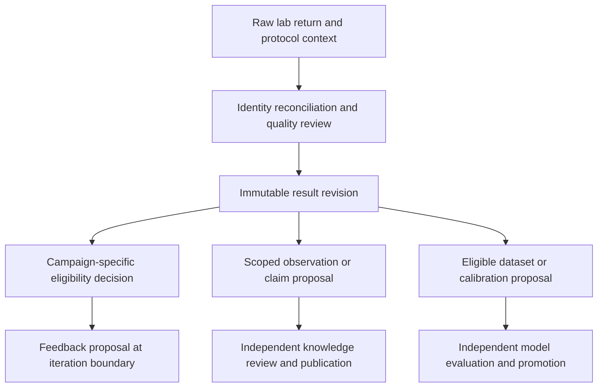

# Experiments and Feedback

- Design status: detailed proposed contract; implementation and scientific acceptance pending
- Naming note: component/record/operation names below are proposed logical design, not implemented APIs or selected deployment technology
- Last reviewed: `2026-09-22 18:56:40` (America/Chicago)
- Parent: [Domain overview](Research_Architecture.md)
- Requirement source: [Product Requirements](../Product_Requirements.md#lab-in-the-loop-optimization)

## Owned Contract

An experiment binds hypothesis, samples/candidates, protocol/method revision, controls, replicates, instruments/calibration, conditions, expected returns and acceptance policy. Samples, aliquots and preparation retain custody. Immutable results preserve raw artifacts, measurements, units, uncertainty, deviations, negative findings and disposition.

A configurable workflow is plan -> issue/acknowledge -> wait -> ingest -> reconcile -> quality/applicability review -> interpretation. Historical or external results enter with truthful lineage, not invented campaign ancestry.

## Boundary and Feedback

Data owns connectors and artifacts; Capabilities supplies analysis; Campaigns owns wait/retry/resume and next-step execution. Eligible measurements can update local fitness or experimental choices under campaign policy. Broader claims go through Knowledge review; model calibration goes through Data's evaluated lifecycle. These are separate promotion paths.

## Invariants and Verification

Match sample/candidate revisions. Do not turn missing or censored values into zero. Preserve failed controls and contradictions. Submission reconciliation and result-ingestion idempotency are distinct. Corrections supersede results and identify affected decisions. Verify partial/late/corrected returns, incompatible methods, waiting recovery and feedback traceable to raw files. Synthetic fixtures establish workflow behavior only.

## Component and Object Design

| Proposed component | Owned records and behavior |
|---|---|
| Experiment aggregate | Hypothesis, protocol revision, sample/candidate bindings, expected returns and lifecycle |
| Sample/custody ledger | Sample, aliquot, preparation and custody transitions with actor/time references |
| Return reconciler | External submission/result identifiers, batch completeness and identity-match dispositions |
| Evidence adjudicator | Control checks, method comparability, result revisions and campaign-use eligibility |

An observation must support numeric, categorical, censored and curve/series forms without forcing them into one numeric column. It binds method, units, context, replicate/control association, raw artifact and uncertainty. Corrected lab reports create superseding records; the original remains historical evidence subject to retention policy.

## Lifecycle and Two Feedback Transactions

An illustrative lifecycle is `planned -> approved -> issued -> acknowledged -> running -> partially returned -> reviewable -> interpreted -> closed`; cancellation, failure and disputed identity are explicit branches. External status does not itself decide scientific acceptance. Expected-result policy determines when a partial batch may be interpreted.

First, commit a measurement eligibility decision for a particular campaign purpose and emit a feedback proposal with exact result revisions. Campaigns applies it at a declared iteration boundary. Separately, submit an observation/claim proposal to Knowledge; its publication has an independent review/revision. Model-training requests similarly create Data work, never a direct live-model replacement.

## Failure and Boundary Example

A corrected concentration arrives after population selection. Retain the old selection, mark it affected, and propose reevaluation with the corrected result revision. If custody cannot match the sample, quarantine the result from candidate fitness while preserving the source delivery. Repeated webhook delivery is deduplicated by source/result identity; that does not establish experiment-submission idempotency.

## Design Basis and Open Decisions

[Acquisition Design](../Data_Sources_and_Acquisition.md) governs transport/artifacts; [Tool Execution](../Scientific_Tools_and_Graph_Execution.md) governs waits and handles. Remaining decisions: LIMS/CRO protocol adapters, method-specific minimum metadata and completeness/control policies. No default statistical exclusion or interpretation rule is implied.
