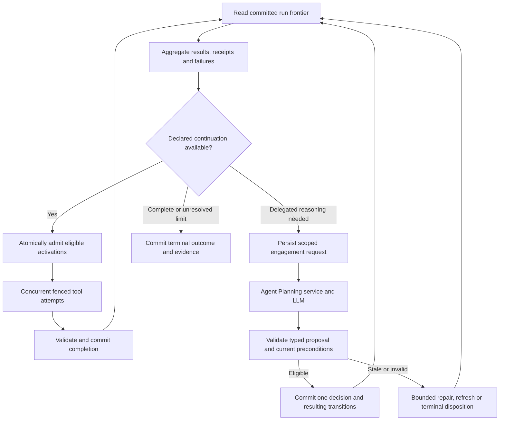

# Graph Runner and Campaign Supervision

- Design status: accepted architectural direction; implementation and schemas pending
- Last reviewed: `2026-09-23 09:48:47` (America/Chicago)
- Parent: [System Architecture](System_Architecture.md)
- Scope: concurrent execution coordination, outcome aggregation, failure handling and durable LLM engagement

## Role and Authority

Graph Runner is the execution/supervision component of the Campaign Runtime service. It is not an additional service with another run database or workflow engine. Runtime-owned API and coordinator processes operate through the same application/transaction contracts. One fenced coordinator owns a run initially; tool replicas execute concurrent invocations without acquiring graph authority.

The runner interprets the pinned execution plan, tracks the committed frontier, aggregates outcomes and requests reasoning when the graph/policy delegates a decision to an LLM. Deterministic readiness, joins, retry eligibility and budget enforcement remain executable runtime rules. The Agent Planning service owns context/model invocation and returns typed proposals; only the runner can accept a proposal into execution state.

## Focused Internal Modules

| Module | Owns | Does not own |
|---|---|---|
| Execution coordinator | Activation readiness, dispatch, attempt leases/fences, deadlines, resource admission and recovery | Scientific calculations or model-authored execution authority |
| Outcome aggregator | Committed-result sets, join/collection predicates, domain acceptance receipts, completeness and unresolved outcomes | A second result store, scientific ranking policy or arbitrary averaging of tool scores |
| Campaign supervisor | Progress/failure assessment, engagement triggers, decision scopes, proposal validation routing and bounded continuation | Direct provider calls, private domain-table reads or changes to signed constraints |

Keep these under focused `services/campaign_runtime/` modules with explicit contracts and replacement READMEs. They share the runtime's transaction authority, not unrestricted mutable module state. A state committer supplies conditional transitions; the interpreter supplies control semantics. Agent Planning and tool services remain separately isolated public-contract consumers/providers.

## Main Loop

The repair/refresh edge consumes a recorded budget and deadline. A terminal outcome does not restart automatically. Independent branches continue while an engagement is pending unless its decision scope explicitly blocks them. Neither a slow model nor an unavailable optional tool should freeze unrelated eligible work.

## Concurrent Aggregation

Activation identity includes the definition node, iteration and expansion path. Aggregate accepted logical outputs once, not every delivery or attempt. A join binds its named predecessor requirements; a collection binds its expected members, accepted domain receipts, closure policy and deadline. Missing, skipped, failed, scientifically rejected, abstained and cancelled inputs remain distinct.

The declared collection policy decides whether all results, a permitted subset or a deadline closes the set. Late arrivals remain attributable but cannot silently change an already-used aggregate or fitness decision. Record included/excluded members and reasons in a versioned aggregation receipt. Scientific selection is a capability/policy consuming that receipt, not a generic runner score computation.

Runtime acceptance and scientific-domain acceptance may be separate transactions. Aggregation must wait for the appropriate Research/Knowledge receipt when the plan requires it, exposing that wait explicitly. Rebuild aggregation state from committed inputs and receipts after restart. Do not use transient progress notifications or a UI projection as its source of truth.

## Failure and Continuation Policy

| Situation | Runner behavior |
|---|---|
| Retryable pure/idempotent tool failure | Apply pinned retry/backoff/attempt limits; allocate a new fence; preserve failed attempt |
| Invalid contract, unsupported version or domain mismatch | Reject result; follow declared failure route or terminate affected work; never coerce success |
| Scientific rejection or insufficient evidence | Keep scientific disposition; follow authorized alternative/acquisition branch or delegated reasoning |
| Uncertain external effect | Reconcile durable intent/provider correlation; never blindly repeat an experiment or paid effect |
| Required predecessor permanently unavailable | Apply explicit join/failure policy; continue independent branches where permitted |
| Model unavailable, repeated invalid proposals or exhausted budget | Follow deterministic fallback if declared, otherwise finish with blocked/failed/abstained disposition and next-campaign proposal |
| Emergency termination or revocation | Prevent newly unauthorized work, reject stale actions and reconcile in-flight effects |

Only committed transitions establish completion. A process exit, provider acknowledgement or LLM statement cannot establish a successful scientific outcome. Compensation is an explicit permitted action with its own evidence; cancellation does not undo physical work.

## Durable LLM Engagement

An engagement is a durable runtime-owned decision request, not a chat transcript or another authored graph. Proposed contract records are `EngagementRequest`, `EngagementProposal` and `SupervisionDecision`; Contract Architecture owns their schema publication process.

The request binds run/plan revision, decision identity and scope, observed frontier/aggregation receipt, relevant input/result/knowledge versions, unresolved question, permitted action types, capability versions, grants, budget/deadline and requested output schema. It includes bounded authorized context references and explicit omissions rather than copying the entire graph into a prompt.

Persist request plus outbox intent before invoking Agent Planning outside the database transaction. Agent Planning records prompt/model configuration, context/retrieval provenance, call attempts and actual output; the runtime retains the returned artifact references and proposal binding. Logical engagement identity is distinct from provider-call attempt identity. Duplicate delivery does not create another accepted decision. Lost provider acknowledgements use reconciliation where available; an unavoidable repeated model call consumes budget and is recorded rather than described as exactly-once.

Lifecycle is `requested -> in flight -> proposed -> accepted / rejected / stale / expired / failed / cancelled`. A bounded repair or refreshed context creates an attributable successor attempt/request. Recovery reconciles outstanding requests and accepts at most one decision for a decision scope/revision. Duplicate or late responses remain diagnostic evidence without restarting closed work.

## Stale Proposals and Decision Races

LLM responses are based on a historical frontier. At acceptance, validate schema, exact capability identities, scientific applicability, allowed action, current grants, resource budget and decision preconditions. Compare relevant input/aggregation versions, not merely the fact that the global run revision changed: an unrelated branch completing need not invalidate the proposal.

Initially permit one active engagement per overlapping decision scope. Independent scopes may reason concurrently, but shared budget and state changes still commit conditionally. Reserve a decision identity when engaging; atomically mark it accepted with the resulting runtime transitions and audit/outbox events. Deterministic fallback and model response compete through the same precondition, so only one can win.

If a relevant result arrives while the model reasons, mark or re-evaluate the stale proposal. Never apply it by silently substituting new inputs. Repair/re-engagement must preserve lineage, respect total limits and release expired reservations. Proposed changes to shared objects require their owning service's versioned acceptance receipt; a model proposal itself is not that receipt.

## Autonomy and Graph Changes

Initial campaigns require no routine human intervention. The supervisor may request interpretation, choose among registered alternatives or adjust permitted parameters only within the pinned campaign contract. It cannot expand its permissions, relax hard constraints, invent tools or promote claims solely to obtain progress.

Machine topology changes create validated successor-campaign proposals with explicit carried-state mapping. Finish/terminate the current campaign and reconcile effects before admitting a successor under the single-active-campaign profile. Human edits are staged for later campaigns and never enter the current iteration. If autonomous continuation cannot satisfy the contract, record a terminal reason and next-campaign proposal rather than waiting indefinitely for a person.

## Verification Gates

Before acceptance demonstrate: concurrent branches plus a join; one branch failing while another continues; partial and late-result policy; duplicate/stale completion; required domain-receipt waits; model latency without unrelated-branch starvation; relevant versus irrelevant frontier changes; conflicting proposals/fallback races; recovery before/after request dispatch and decision commit; model timeout and bounded repair exhaustion; cancellation/revocation during a call; and successor topology without hot-swapping active instructions.

Expose current frontier, unresolved dependencies, decision scope, engagement status, retries/budget and reason-coded continuation/termination through versioned UI projections. These are proposed architecture/test obligations, not implemented guarantees.
