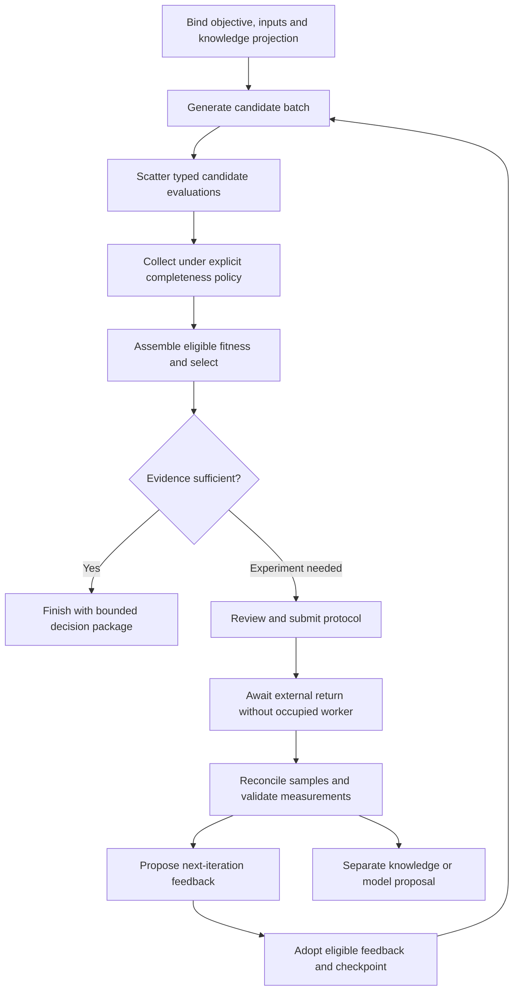

# A Research Loop Through the System

- Design status: proposed end-to-end execution scenario
- Parent: [System Architecture](System_Architecture.md)
- Scope: demonstrate actual graph execution, storage and feedback boundaries
- Scientific posture: illustrative mixed materials/biology campaign; required scientific tools may be unavailable and must then appear as gaps

## Initial Conditions

Profile clarification (`2026-09-22 21:03:27`): this is an illustrative scientific scenario, not selection of the first application. Initial releases use one autonomous campaign and synthetic scientific fixtures as needed. Review/approval steps below run through configured policy and eligible automated reviewers, not routine human gates. Human edits and proposed knowledge overrides apply to later campaigns; missing unresolvable prerequisites terminate with a truthful disposition. Bio-available polymers are a likely future use, with actual inputs TBA.

A scientist wants to compare delivery designs under a defined release endpoint and assay context. Research has a signed objective revision `O1` and domain-specific design space `D1`. Knowledge has accepted graph revision `K7`. Capabilities has eligible generation, evaluation and lab-adapter versions, or exposes missing capabilities. No performance or clinical validity is inferred by naming these tools.

The LLM planner receives bounded context references, not the whole knowledge graph: objective `O1`, design space `D1`, an authorized projection of `K7`, relevant tool descriptors and resource limits. It emits campaign proposal `G3`. Policy-bound automated review and deterministic checks resolve plan `P3`; the activation receipt binds its hash and lockfile.

## Executable Research Pattern

This is one authored graph, not engine hard-coded orchestration. A biology-only campaign may use different generation/evaluation tools and omit material processing. A failed applicability check can route to data acquisition, human review or explicit termination.

## Process and Transaction Walkthrough

| Step | Executing component | Durable outcome |
|---|---|---|
| 1. Activate | Control API -> activation command | Run `R1` pins `P3/O1/D1/K7`, inputs, budget and review receipt |
| 2. Generate | Coordinator dispatches worker | Attempt with fence; worker proposes candidate artifact batch and generator checkpoint |
| 3. Commit candidates | Completion command | Accepted batch reference, candidate attempts, loop state and audit event; duplicate attempts retained |
| 4. Evaluate | Interpreter scatters activations | One activation path per candidate/evaluator/iteration, exact tool/model/context bindings |
| 5. Select | Selection capability + commit command | Typed eligible fitness inputs and policy-bound selection receipt; no LLM prose score |
| 6. Request experiment | Protocol/review node then lab adapter | Approved protocol revision, durable submission intent and external job identity |
| 7. Wait | No worker held | Node waits on correlation/return policy; UI reads persisted state |
| 8. Receive | Callback/acquisition adapter and evidence tools | Raw artifact, reconciled sample/result revision and quality/applicability disposition |
| 9. Apply feedback | Iteration transition | New loop-state revision binds eligible result; next generation uses exact recorded feedback |
| 10. Publish knowledge | Separate reviewed knowledge command | New `K8` revision; it does not retroactively replace `K7` in the running iteration |

The browser observes event-triggered projection refreshes throughout. It can display committed runtime status before slower explanatory projections catch up, but must label their differing revisions/freshness. Inspection of an older selection keeps its original model, knowledge and result references.

## What Happens When Things Change

**A worker returns twice.** The same command identity returns its recorded receipt. A replacement attempt has a newer fence; an older completion cannot update state. The coordinator derives next-node readiness from committed output, not the number of delivery messages.

**Lab submission times out.** The durable intent remains uncertain until the adapter queries the provider or a reviewer resolves it. The run waits; it does not resubmit by default. Budget and expected-result state remain attached to the logical operation.

**A lab result is corrected.** Create result revision `M2` superseding `M1`. Identify selections and feedback consuming `M1`; propose reevaluation or review. Old decisions retain `M1`; future use of `M2` is explicit.

**The scientist changes the research pathway.** Editing stages `G4/P4` for a subsequent campaign. `R1` keeps its pinned pathway through completion or termination; reconcile external effects before starting successor `R2` with explicit carried candidate/result/state references. Invalid state mappings must be recomputed or rejected. Human edits do not enter `R1` at iteration boundaries.

**New knowledge contradicts a constraint.** `K8` publication identifies impacted consumers. It can trigger a pause/review policy or be proposed at the next iteration boundary. It cannot silently change a fitness vector already used in selection.

## First System Proof

Run this pattern with deterministic synthetic generation/evaluation and a fake lab adapter, plus one narrowly applicable v1-derived calculator adapter when available. Demonstrate parallel evaluation, automated review, a simulated external-response wait, one feedback iteration and graph revision succession between campaigns. Include an unresolvable input case that ends with a recorded blocker rather than a human approval wait. Kill the coordinator and a worker at defined commit/acknowledgement boundaries and show no lost accepted state or duplicated accepted effect.

The proof establishes system semantics, not drug-delivery validity. Production scientific tools, provider integration and human usability each retain their own acceptance gates. If the system cannot execute this minimal pattern with clear ownership and recovery, adding more capabilities or autonomous topology evolution is premature.
