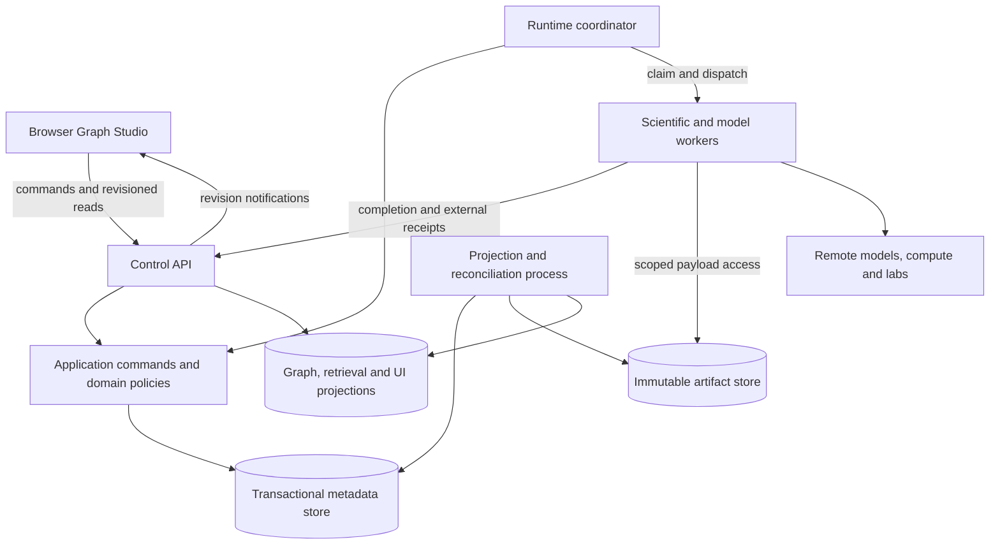

# Runtime Topology

- Design status: proposed initial physical/logical topology
- Parent: [System Architecture](System_Architecture.md)
- Scope: executable processes and their trust, latency and failure boundaries

## Initial Deployment Shape

The user-selected baseline is one server running a browser-facing control API, a runtime coordinator, background projection/reconciliation work, transactional storage, artifact storage and one or more tool workers. Model endpoints, specialist compute and laboratories may be remote. A browser is a client, not an execution host. This is a single-node operating profile, not a resilience claim.

The diagram separates executable processes from internal modules and stores. `Application commands and domain policies` is shared code called by the API and coordinator, not another network service. The coordinator and API may write metadata only through those commands. Workers have no general database write access.

## Process Responsibilities

The first operating profile admits one active campaign for one internal user. Parallel nodes do not imply concurrent campaigns. Deployment targets are a DGX Spark or a partner Threadripper host; verify target architecture, OS, dependencies and accelerator requirements during packaging rather than assuming identical binaries. Model hosting and data-egress policy remain open; source availability does not block synthetic runtime fixtures. No enterprise capacity or availability promise is part of this profile.

| Process | Does | Must not do |
|---|---|---|
| Control API | Authenticate, validate command envelopes, run short application transactions, serve projections and notify changes | Run expensive chemistry/model jobs synchronously or accept worker claims as authoritative state |
| Runtime coordinator | Evaluate durable readiness, commit dispatch intent, allocate attempts/leases, enforce budgets and handle timeouts | Keep the only copy of graph position in RAM or infer success from a transport acknowledgement |
| Worker runner | Resolve a specific invocation, fetch granted inputs, execute a reviewed adapter and upload provisional outputs | Select arbitrary successors, overwrite graph definitions or commit scientific authority |
| Projection/reconciliation process | Build snapshots/indexes, deliver recoverable events, refresh UI views and reconcile uncertain provider outcomes | Become the sole store of accepted state or retry an ambiguous external action blindly |
| Model endpoint | Serve pinned generation/inference requests under declared availability and privacy limits | Own campaign flow or promote its outputs |

Begin with one coordinator owner per run. Multiple coordinator processes can be introduced only with database-backed ownership/fencing; process-local locks do not protect shared state. Worker classes isolate different resource and trust needs: pure calculators, heavy simulations, model calls and external-action adapters. They may share runner code while using different grants, runtimes and concurrency limits.

## Communication and Backpressure

### Placement of Scientific and Model Work

| Work | Execution placement | State/result boundary |
|---|---|---|
| Branch, join, bounded-loop readiness | Coordinator's deterministic interpreter | Reads committed values and emits runtime transitions |
| Candidate generation, GA step, simulation, custom model | Scientific worker, possibly remote | Receives pinned input/checkpoint artifacts and returns proposed outputs |
| LLM graph design or feedback proposal | Model-call worker/provider adapter | Produces typed proposals; no direct graph activation or run-state mutation |
| Knowledge projection and symbolic evaluation | Scoped query/projection path; costly reasoning can run as a worker activity | Pinned assertions/rules and explicit result lineage; no implicit latest-graph read |
| Lab submission and ingestion | External-action/acquisition worker | Durable intent, provider correlation and reconciled artifacts |

The interpreter can therefore keep progressing through eligible deterministic work while an LLM, laboratory or simulation is unavailable. It stops only dependent activations and records why. A model is a capability provider, not the continuously running controller of every node.

Human/API commands are synchronous only through validation and durable acceptance; return object/run/task references for ongoing work. Dispatch and completion are asynchronous protocols. A durable dispatch record exists before notification, so a lost message cannot lose work. Initially a database-backed work queue can be the source of dispatch readiness; an external broker may later carry wakeups without becoming execution truth.

Bound concurrency by tenant/project budget, worker capability, provider quota and run limits. Admit work before consuming scarce resources. A blocked lab response must not occupy a CPU worker slot: persist an external job handle and a waiting node, then release the worker. Projection lag is displayed separately from run completion.

## Failure Domains and Scaling Seams

- API restart: clients resubmit with the same command identity; accepted commands resolve to their existing receipt.
- Coordinator restart: reconstruct run position/readiness from committed records, recover expired leases and reconcile pending effects.
- Worker death: retry pure/idempotent work under a new attempt fence; reconcile effectful work before resubmission.
- Projection failure: stop claiming freshness; rebuild from source state/events without changing accepted scientific results.
- Server/store loss: restore a consistent metadata/artifact recovery point. No initial failover guarantee is assumed.

Scale workers first for independent expensive work. Separate retrieval/index builders when they compete with interactive capacity. Split control-domain services only when measured contention, isolation or deployment needs justify the distributed transaction cost. Large graph display is a projection/query problem as well as a rendering problem; do not load complete histories into every browser request.

## Deployment Decisions Still Required

Concrete language/framework, packaging, database version, artifact backend, worker isolation, observability and initial resource limits need implementation-plan decisions. PostgreSQL is the proposed transactional baseline in the state design; that recommendation does not select every surrounding library. Remote invocation requires authenticated, scoped transport even when local development uses trusted subprocesses.
