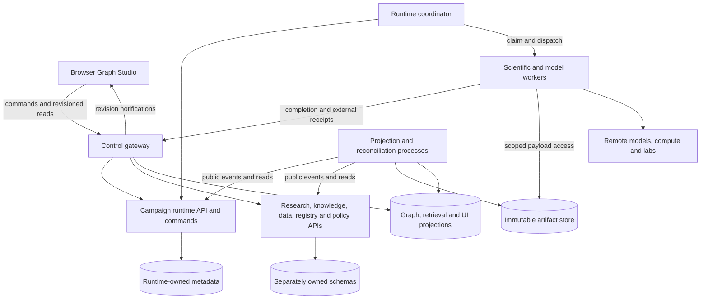

# Runtime Topology

Owner update2026-10-08: LAN-01 adds an opt-in HTTPS browser gateway bound to a
specific private IPv4 address and explicit private client subnet. Scientific APIs,
databases and existing local access remain loopback. The gateway owns secure
browser sessions and exact-origin validation; operators own certificate trust and
firewall scope. This supersedes the computer-only access restriction below for
the internal demonstration, without enabling internet or multi-user deployment.
See [LAN access runbook](../../LAN_Demo_Access.md).

- Design status: bounded Windows single-server profile implemented and exercised; broader host/fleet profiles remain proposed
- Parent: [System Architecture](System_Architecture.md)
- Scope: executable processes and their trust, latency and failure boundaries

## Initial Deployment Shape

The user-selected baseline is one server running a browser-facing control API, a runtime coordinator, background projection/reconciliation work, transactional storage, artifact storage and one or more tool workers. Model endpoints, specialist compute and laboratories may be remote. A browser is a client, not an execution host. This is a single-node operating profile, not a resilience claim.

The gateway routes to isolated owners. The campaign-runtime API and coordinator share only their owning runtime package and transaction rules. Domain services expose public contracts and own their schemas/roles, even when PostgreSQL is one installation. Projection consumers use public events/reads; they do not bypass private state ownership. Tool service replicas have no general database write access. See [Service Isolation](Service_Isolation.md) for the ownership map; the diagram groups services for readability, not as a catch-all backend.

## Process Responsibilities

[Graph Runner](Graph_Runner.md) names the execution coordinator, outcome aggregator and campaign supervisor inside Campaign Runtime. Agent Planning remains an isolated service that returns typed LLM proposals through durable engagements. Slow model calls do not hold runtime transactions or block unrelated branches; one conditional runtime commit accepts each supervision decision.

The first operating profile admits one active campaign for one internal user. Parallel nodes do not imply concurrent campaigns. The owner selected the current Windows x86_64 computer and loopback-only access for initial deployment. DGX Spark and a partner Threadripper remain future targets; verify OS, dependencies and accelerator requirements for each profile. BP-09.02 qualifies isolated owner APIs, local persistence and browser transport; BP-09.03 owns autonomous worker/model composition. Synthetic evaluation authorization does not establish scientific efficacy. No enterprise capacity or availability promise is part of this profile.

| Process | Does | Must not do |
|---|---|---|
| Control gateway | Authenticate browser sessions, bound transport and route public owner requests | Run owner transactions, scientific/model jobs or accept worker claims as authoritative state |
| Owner APIs | Validate owned command envelopes, commit short owner transactions and serve owned projections | Import private peer implementations or read/write another owner's tables |
| Runtime coordinator | Evaluate durable readiness, commit dispatch intent, allocate attempts/leases, enforce budgets and handle timeouts | Keep the only copy of graph position in RAM or infer success from a transport acknowledgement |
| Worker runner | Resolve a specific invocation, fetch granted inputs, execute a reviewed adapter and upload provisional outputs | Select arbitrary successors, overwrite graph definitions or commit scientific authority |
| Projection/reconciliation process | Build snapshots/indexes, deliver recoverable events, refresh UI views and reconcile uncertain provider outcomes | Become the sole store of accepted state or retry an ambiguous external action blindly |
| Model endpoint | Serve pinned generation/inference requests under declared availability and privacy limits | Own campaign flow or promote its outputs |

Begin with one coordinator owner per run. Multiple coordinator processes can be introduced only with database-backed ownership/fencing; process-local locks do not protect shared state. Worker classes isolate different resource and trust needs: pure calculators, heavy simulations, model calls and external-action adapters. They may share runner code while using different grants, runtimes and concurrency limits.

## Communication and Backpressure

### Placement of Scientific and Model Work

| Work | Execution placement | State/result boundary |
|---|---|---|
| Branch, join, bounded-loop readiness | Coordinator's deterministic interpreter | Reads committed values and emits runtime transitions |
| Candidate generation, GA step, simulation, custom model | Scientific worker, possibly remote | Receives pinned input/checkpoint artifacts and returns proposed outputs |
| LLM graph design or feedback proposal | Model-call worker/provider adapter | Produces typed proposals; no direct graph activation or run-state mutation |
| Knowledge projection and symbolic evaluation | Scoped query/projection path; costly reasoning can run as a worker activity | Pinned assertions/rules and explicit result lineage; no implicit latest-graph read |
| Lab submission and ingestion | External-action/acquisition worker | Durable intent, provider correlation and reconciled artifacts |

The interpreter can therefore keep progressing through eligible deterministic work while an LLM, laboratory or simulation is unavailable. It stops only dependent activations and records why. A model is a capability provider, not the continuously running controller of every node.

Human/API commands are synchronous only through validation and durable acceptance; return object/run/task references for ongoing work. Dispatch and completion are asynchronous protocols. A durable dispatch record exists before notification, so a lost message cannot lose work. Initially a database-backed work queue can be the source of dispatch readiness; an external broker may later carry wakeups without becoming execution truth.

Bound concurrency by tenant/project budget, worker capability, provider quota and run limits. Admit work before consuming scarce resources. A blocked lab response must not occupy a CPU worker slot: persist an external job handle and a waiting node, then release the worker. Projection lag is displayed separately from run completion.

## Failure Domains and Scaling Seams

- API restart: clients resubmit with the same command identity; accepted commands resolve to their existing receipt.
- Coordinator restart: reconstruct run position/readiness from committed records, recover expired leases and reconcile pending effects.
- Worker death: retry pure/idempotent work under a new attempt fence; reconcile effectful work before resubmission.
- Projection failure: stop claiming freshness; rebuild from source state/events without changing accepted scientific results.
- Server/store loss: restore a consistent metadata/artifact recovery point. No initial failover guarantee is assumed.

Scale workers first for independent expensive work. Separate retrieval/index builders when they compete with interactive capacity. Keep primary services behaviorally and functionally isolated from the first implementation. Change physical placement or further decompose owners when measured contention or deployment needs justify it; never relax public-contract/state boundaries to co-locate them. Large graph display is a projection/query problem as well as a rendering problem; do not load complete histories into every browser request.

## Deployment Decisions Still Required

Concrete language/framework, packaging, database version, artifact backend, worker isolation, observability and initial resource limits need implementation-plan decisions. PostgreSQL is the proposed transactional baseline in the state design; that recommendation does not select every surrounding library. Remote invocation requires authenticated, scoped transport even when local development uses trusted subprocesses.

## Selected local profile

Owner decision 2026-10-06 21:41:09: use the current local computer with computer-only access. BP-09.01 qualifies Windowsx86_64/Python3.12 process compatibility, localNTFS artifact storage and127.0.0.1 routing. Independent service installation and bounded synthetic integrated demonstration passed BP-09.02/.03. DGX Spark, partner Threadripper, LAN exposure and K3s remain future selections. Preflight is not powerloss/backup or serviceauthentication proof.

Reviewed 2026-10-07 10:34:21: BP-09.04 verifies a drained cold backup and separately named same-host restore, complete artifact-reference integrity, and an independent synthetic evaluator replacement. Recovery excludes host-loss/online backup; elapsed infrastructure restoration is separate from later semantic qualification. Earlier intermittent worker faults remain unresolved operational findings; no unattended reliability or soak claim. See [scoped recovery audit](../../Audits/BP-09.04_Recovery_Replacement_Closeout.md).
