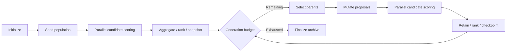

# V1 Solver Behavior Baseline

- Status: source-extracted reference plus structurally valid v2 scaffold; not execution verified.
- Reviewed: `2026-09-24 09:00:00` (America/Chicago).
- Owner: Campaign Runtime; BP-04 orchestration parity, BP-03 synthetic adapters, BP-08 scientific search integration.

[behavior_graph.json](behavior_graph.json) records the frozen CLI `run_solver` control flow, source hashes (UTF-8/LF normalized for cross-platform checkout)/line ranges, retained state, failure/cancellation behavior and ordered native scoring chains. Candidate batches run concurrently; modules within a candidate run sequentially. The CLI admits the molecule lane only; formulation and evidence chains are engine alternatives, not reachable CLI solver branches.

[campaign_scaffold.json](campaign_scaffold.json) uses the present CampaignDefinition contract with an explicit two-iteration body. Its invocation bindings use **synthetic fixture-only identity digests**, not deployable image digests. Stages are opaque adapter placeholders; data bindings, candidate scatter/gather, error routes, cancellation and retained-state commits are not implemented by this scaffold. Structural admission must continue returning `executable=false`. Do not register these as real capabilities or claim that matching the scaffold proves matching execution.

## Parity gates for the future runner

| Scenario | Required observable behavior |
|---|---|
| Zero generations | Initial population scored and archived, no offspring iteration |
| Two generations | Deterministic seed schedule; current population replaced, cumulative results retained; one checkpoint per completed generation |
| Partial scoring failure | Preserve request/result association despite completion order; omit failed candidates and record failure |
| Mutation rejection | Record rejection, score accepted proposals only; preserve compacted scoring seed indexing |
| All scoring failed | v2 terminates with a truthful blocked/failed outcome; do not copy v1's possible empty-parent modulo/index panic |
| Capability error | Fail-closed ERROR envelope retains missing authority; other modules still evaluated |
| Cancel between generations | No subsequent dispatch; explicit v2 terminal outcome (v1 returns without normal finalization) |
| Restart after commit | v2 recovers committed frontier without duplicate acceptance; this is a v2 requirement, not observed v1 behavior |

BP-04 must implement deterministic synthetic adapters and assert these outcomes, stage traces, collection membership and event ordering against reviewed fixtures. BP-08 adds genuine scientific transformations/selection with separate evidence. Current tests check source integrity, ordered module extraction and scaffold structure only; no Rust run was performed.

The frozen `mutate` function changes IDs/lineage without molecular structure changes (`QUARANTINED_NO_STRUCTURE_CHANGE`). `rank_candidates` sets `ranked=false` and has no eligible objective vector. Neither separate authorized molecule generation nor numerical NSGA-II is called by this CLI loop. Preserve these distinctions so the initial graph remains a useful orchestration baseline without turning epoxy-specific internals into engine primitives.
